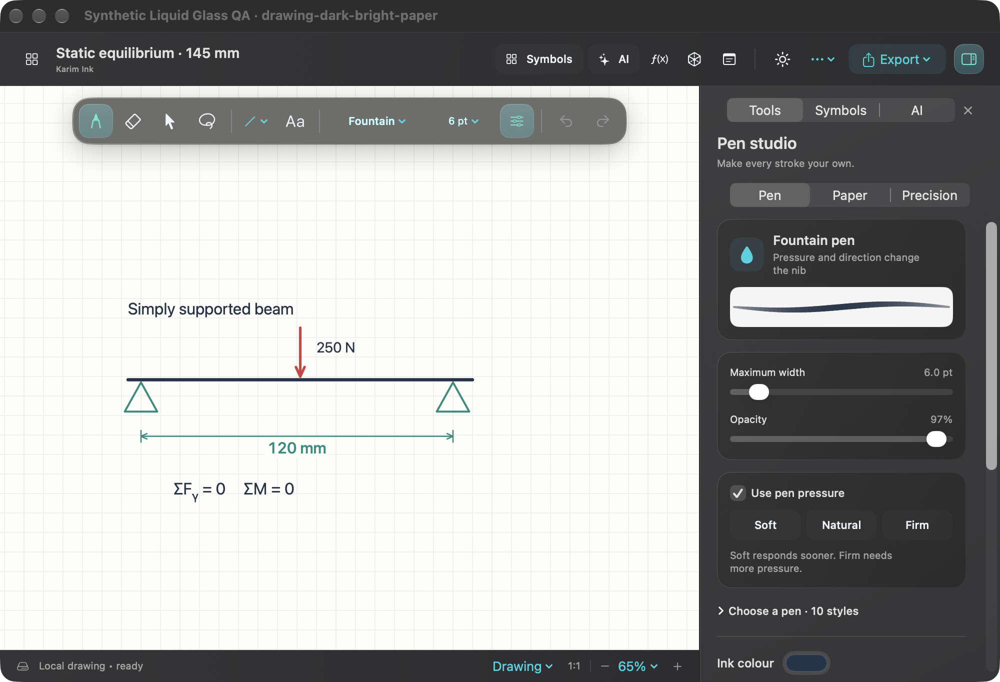

# Karim Ink 0.1 Preview

A native Mac whiteboard for maths, engineering notes and student sketches, made by **Karim Eldamaty**.

[Download the Mac preview](https://github.com/12kareem2323-png/karim-ink/releases/tag/v0.1.0) · [Report a bug or suggest a feature](https://github.com/12kareem2323-png/karim-ink/issues) · [Privacy](PRIVACY.md)

**Mac release only. Windows is coming soon.** This free, unnotarized preview targets Apple Silicon Macs running macOS 14 or later. It has been tested on an Apple Silicon Mac running macOS 27.2; older target versions and Intel Macs have not been runtime-tested. Local language-model chat needs macOS 26 or later, compatible hardware and a ready Apple Intelligence model.

## Start drawing

1. Download the Mac release from the link above.
2. Open the download and move **Karim Ink.app** to **Applications**.
3. Open Karim Ink, create a drawing and choose a pen and paper.

This preview has an **ad hoc code signature**, not an Apple Developer ID signature, and **has not been notarized by Apple**. It is distributed outside the Mac App Store. macOS may block the first launch. Check the release's SHA-256 checksum and read [Support](SUPPORT.md) for Apple's per-app Open Anyway instructions. Keep macOS security protections enabled.

Drawing, local saving, engineering tools and single-symbol recognition work offline. Cloud AI and Craft updates need internet. No account is needed for ordinary drawing.

## What is included

### Drawing and the Mac workspace

- A native SwiftUI/AppKit interface with floating frosted-glass controls, light/dark/system appearance and a focus-canvas mode.
- Pan and zoom around your drawing. Newly drawn strokes stay unselected; Select and Lasso are separate tools.
- Ten brushes: Technical Fineliner, Fountain, Graphite Pencil, Chalk, Marker, Calligraphy, Airbrush, Liquid Ink, Highlighter and Dry Erase.
- Adjustable colour, width, opacity, texture, smoothing and pressure response, plus pencil grades from 2H to 6B.
- Ten paper styles: Plain, Lined, Square Grid, Dot Grid, Graph Paper, Engineering Sheet, Blueprint, Isometric, Polar Grid and Dark Board.
- Lines, arrows, rectangles, circles, triangles, arcs, dimensions and editable text. Hold a rough stroke still for about half a second to try shape correction; give corrected lines an exact length in millimetres.
- Ruler, protractor, physical drawing scale, scientific calculator, unit conversion, function plotting and optional isometric snapping.
- Standard AppKit pen input for pressure, tilt, hover and eraser events when the tablet's macOS driver provides them. Mouse and trackpad drawing also work. Physical operation varies by tablet and driver and has not been verified across brands.

### Symbols, maths and handwriting

- **380 searchable teaching symbols and diagrams** across algebra, calculus, Greek letters, geometry, statistics, electrical, electronics, digital logic, mechanics, fluids, technical drawing and manufacturing.
- Drag-and-drop placement, repeated stamping and optional short animations for selected diagrams. Animations explain movement; they do not simulate engineering behaviour.
- An offline DeTeXt/Core ML recognizer with **1,098 command definitions**. Draw one symbol or use selected ink, review candidates, copy LaTeX or send a result to the formula editor.
- An editable formula editor with a supported LaTeX subset, including common fractions, roots, powers and operators. Whole handwritten equations must be assembled and checked manually.
- Local ink smoothing, Apple Vision text recognition and spelling suggestions. Review text before inserting or replacing content; replacement edits can be undone.
- Optional AI chat through Apple's available on-device model or the OpenAI API. The cloud option needs your own API key and separate API billing. A ChatGPT subscription does not supply API access. The app shows the route before Send; board images are attached only when you choose to attach them.

### Files, sketches and other apps

- A home library with recent drawings, folders, search and cached previews; local autosaving, save-conflict protection and recovery copies.
- Editable `.engboard` drawings; PDF, PNG and JPEG exports; image/PDF import, image/text paste and native links that reopen a saved board in the Mac app.
- A student **3D Sketchbook** with Front/Top/Side sketch planes, boxes, cylinders, spheres, scene Undo/Redo, editable `.karim3d` files and draft recovery. Board previews retain their editable scene. This is a concept-sketch tool, not a CAD or manufacturing-validation system.
- Excalidraw export and optional **one-way Craft updates** for basic paths, shapes, text and dimensions. Rich brush textures and images require an export copy.
- An offline **Notion HTML companion** with a rendered board background and new web ink. Upload/embedding depends on the workspace. It does not embed the native Mac app or provide two-way sync.
- Reduced Transparency and Reduced Motion support, independent paper colours and keyboard shortcuts for common drawing actions.

## Preview limits

This is an independent student project. The symbol library is a teaching aid, not an IEC/ISO-certified library or a Pearson-endorsed product. Check the convention your assignment requires.

Large drawings and zoom rebuilds can still pause. Metal accelerates active ink, but 120 FPS and a particular latency are not guaranteed. Physical tablet/remote behaviour, cloud account connections and older supported macOS versions need broader testing. Multiplayer, full handwritten-equation recognition, circuit/beam simulation and CAD constraints are not included.

Keep backups of important editable drawings. Check OCR/AI results, especially numbers, units and engineering notation.

## Source, feedback and support

[Downloads, documentation and issues](https://github.com/12kareem2323-png/karim-ink) · [Release notes](RELEASE_NOTES.md) · [Support](SUPPORT.md) · [Security](SECURITY.md) · [Third-party notices](THIRD_PARTY_NOTICES.md)

Website: [Karim Ink](https://karim-ink.stonyvale1.chatgpt.site) · [GitHub Pages mirror](https://12kareem2323-png.github.io/karim-ink/) · [Karim’s launch announcement](https://www.linkedin.com/feed/update/urn:li:activity:7515116683393572865/).

The app uses Swift, SwiftUI, AppKit, Metal, Core ML, Vision and SceneKit. This repository hosts Mac downloads, documentation and feedback. [Build notes](BUILDING.md) describe the development project and release process; they do not imply that the full source is published here.

Verified payment links will be added after setup. Donations will be optional.
